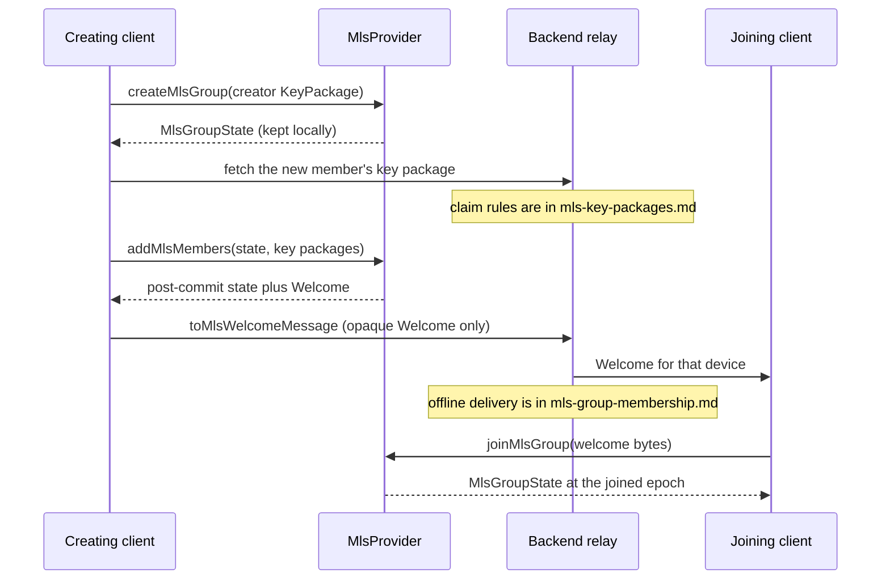

# Concepts: MLS client integration

How the web client creates an MLS group, adds a member, and joins with a Welcome.
This page replaces `apps/web/src/lib/mls-integration.md`. Server storage, key-package
claiming, and epoch membership are not repeated here.

- Key packages: [MLS key packages](../../backend/docs/mls-key-packages.md)
- Group membership and new-device join: [MLS group membership](../../backend/docs/mls-group-membership.md)

> **Stale when:** a caller persists `MlsClient.exportState()`, or
> `apps/web/src/lib/crypto/mls.ts` is wired to `MlsClient`. Update the persistence
> section and the "which module to call" section in that change.

## Which module feature code should call

The two modules are not connected. `lib/crypto/mls.ts` does not import `lib/mls.ts`.
Nothing else in `apps/web/src` calls either one yet. Feature code still has a split
to follow:

| Module | Responsibility | Call it for |
| --- | --- | --- |
| [`apps/web/src/lib/crypto/mls.ts`](../src/lib/crypto/mls.ts) | Client group coordination behind an injected `MlsProvider`. No network, no WASM import. Returns group state and an opaque Welcome. | Creating a group, adding members, joining from Welcome bytes, and building the Welcome payload the existing message pipeline can carry (`toMlsWelcomeMessage`). |
| [`apps/web/src/lib/mls.ts`](../src/lib/mls.ts) | Browser-only adapter over `@openmls/wasm`. Knows the ciphersuite and the WASM method names. Does not know backend routes. | Constructing the WASM client, `encrypt` / `decrypt`, `applyCommit`, and `exportState` / restore. A `MlsProvider` implementation would wrap this class. None is written yet. `MlsClient`'s methods are not the same shape as `MlsProvider`, so it is not a drop-in provider. |

`MlsClient.create` throws `MLS is only available in a browser context` when
`window` is undefined, and throws if the `@openmls/wasm` constructor or a required
method is missing. Do not import it from a Server Component or a route handler.

## Protocol and ciphersuite

- Protocol: Messaging Layer Security (MLS), specified by [RFC 9420](https://www.rfc-editor.org/rfc/rfc9420).
- Selected ciphersuite: `MLS_128_DHKEMX25519_AES128GCM_SHA256_Ed25519`, the
  `MLS_CIPHERSUITE` constant in `apps/web/src/lib/mls.ts`.
- The ciphersuite provides 128-bit symmetric security, X25519 HPKE key agreement,
  AES-128-GCM authenticated encryption, SHA-256 hashing, and Ed25519 signatures.
- Group state transitions, epochs, ratchets, credentials, and private keys are owned
  by the browser-side OpenMLS WASM client.

The application uses OpenMLS for the MLS wire protocol and does not implement MLS
cryptography itself. RFC 9420 conformance is therefore dependent on the selected
OpenMLS release and its upstream test suite. Application-level interoperability
testing against another RFC 9420 implementation remains required before describing
the product as fully interoperable.

## Creating a group, adding a member, joining

`createMlsGroup`, `addMlsMembers`, and `joinMlsGroup` only talk to the `MlsProvider`
the caller passes in. They copy bytes out so the caller cannot alias the provider's
buffers. `addMlsMembers` throws `At least one key package is required` on an empty
list.

Key-package bytes are public material the backend stores and hands out. How a package
is published, deduplicated, and claimed is
[MLS key packages](../../backend/docs/mls-key-packages.md). This client treats a
`KeyPackage` as `{ deviceId, userId, keyPackage: Uint8Array }`.

`toMlsWelcomeMessage` is the client transport shape for that Welcome:

| Field | Value |
| --- | --- |
| `contentType` | `application/mls-welcome` (`MLS_WELCOME_CONTENT_TYPE`) |
| `ciphertext` | base64 of `welcome.ciphertext` |
| `epoch` | the epoch `addMlsMembers` returned |

`MLS_WELCOME_EVENT` is the string `mls_welcome`. The helper does not open a socket
and does not POST. The caller puts that object on the existing message pipeline.

What the relay stores, which epochs a new device can read, and why history from
before the join epoch is unavailable are
[MLS group membership](../../backend/docs/mls-group-membership.md).

The state returned by `addMlsMembers` is the post-commit state. The function's
comment says the creating client is the one that must retain it. `joinMlsGroup`
returns the joiner's own state from `processWelcome`. Neither function writes
those objects anywhere.

## Where group state is persisted

It is not. `MlsClient` holds the OpenMLS instance in memory. `exportState()` returns
opaque bytes (`exportState`, `export_state`, or `serialize` on the binding).
`MlsClient.create(groupId, { credential, state })` passes `options.state` into the
WASM constructor when a caller has those bytes. No module writes the bytes to
`localStorage` or IndexedDB. [IndexedDB schemas](./contracts-indexeddb-schemas.md)
has no MLS store. Grep of `apps/web/src` finds no caller of `MlsClient` or
`exportState` outside `mls.ts` itself.

Reloading the page drops the WASM instance. Clearing site data does not delete a
blob the app never stored, and it also does not restore one. After either, the
browser has no epoch secrets for that group.

Lost with the instance:

- opaque group state, epoch secrets, and ratchet secrets
- MLS signing private keys held inside the WASM client
- the ability to `encrypt`, `decrypt`, or `applyCommit` for that group until this
  device processes a new Welcome and keeps the resulting state

Not lost, because they were never in that blob: ciphertext and public group state
the backend already stored, and key packages already uploaded. Those stay subject
to the membership rules in the backend doc. A cleared browser does not tell the
server that this device forgot the group.

`MlsClient.exportState()` returns opaque state for local browser persistence only.
It must not be included in API requests, WebSocket messages, logs, analytics, or
crash reports. The transport boundary may carry only:

- public credentials and key packages needed for onboarding;
- MLS Welcome, Proposal, and Commit messages;
- MLS ciphertext and authenticated data.

The backend is an untrusted relay and never receives group state, epoch secrets,
ratchet secrets, signing private keys, plaintext, or exported client state.
Decryption occurs only after ciphertext reaches a client holding the corresponding
local group state.

## Audit status

No independent security audit of the exact `@openmls/wasm` artifact, its WebAssembly build, or this adapter has been completed by DripTide. Upstream maintenance and release history are not a substitute for an application-specific audit. The dependency version is explicitly declared in `apps/web/package.json` so upgrades can be reviewed and audited.
