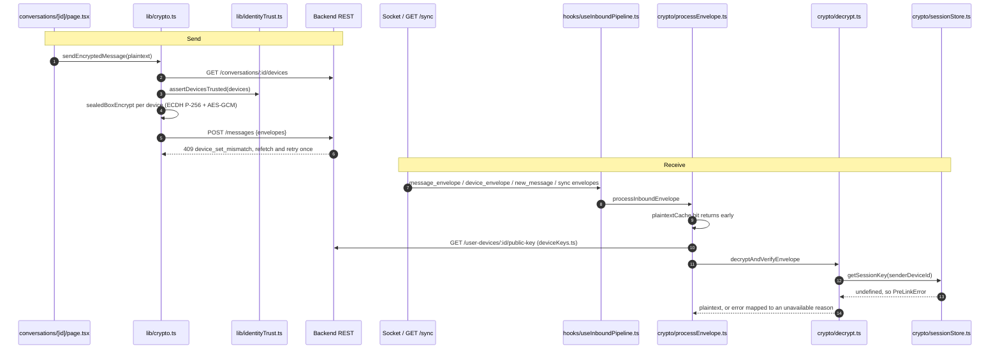

# Client crypto module map

Which crypto-related modules in `apps/web/src/lib/` and `apps/web/src/lib/crypto/` actually run in the app, and which do not. Statuses were checked by following imports from non-test code (`app/`, `components/`, `contexts/`, `hooks/`) on the `dev` branch.

## Status legend

| Status                     | Meaning                                                                                          |
| -------------------------- | ------------------------------------------------------------------------------------------------ |
| **live**                   | Reached from non-test application code on the message path or on another shipped path.           |
| **stub**                   | Placeholder or adapter that is not functional on its own (needs configuration or another piece). |
| **implemented, not wired** | Working code with tests, but no non-test code imports it.                                        |

"Callers" lists non-test importers only. A module that only tests import is listed as "tests only".

## Module table

Paths are relative to `apps/web/src/lib/`.

| Module                      | Status                     | Responsibility                                                                                                                                                                                                                                           | Callers                                                                                                                                          |
| --------------------------- | -------------------------- | -------------------------------------------------------------------------------------------------------------------------------------------------------------------------------------------------------------------------------------------------------- | ------------------------------------------------------------------------------------------------------------------------------------------------ |
| `crypto.ts`                 | **live**                   | Phase-1 sealed-box encryption (`sealedBoxEncrypt`), `fetchConversationDevices`, `buildEnvelopes`, `sendEncryptedMessage` with the `device_set_mismatch` retry.                                                                                           | `app/app/conversations/[id]/page.tsx` (`sendEncryptedMessage`, `fetchConversationDevices`), `fileEncryption.ts` (`buildEnvelopes`), `session.ts` |
| `identityTrust.ts`          | **live**                   | Pins each peer's identity-key set and raises `IdentityKeyChangedError` when it changes.                                                                                                                                                                  | `crypto.ts` (`assertDevicesTrusted`), `signalSession.ts`                                                                                         |
| `deviceIdentity.ts`         | **live**                   | Creates the device's Ed25519 identity key and device id in `localStorage` at sign-in.                                                                                                                                                                    | `contexts/AuthContext.tsx`                                                                                                                       |
| `fileEncryption.ts`         | **live**                   | Encrypts file bytes and thumbnails, then wraps the payload via `buildEnvelopes`.                                                                                                                                                                         | `app/app/conversations/[id]/page.tsx`, `thumbnail.ts`, `components/messaging/EncryptedThumbnail.tsx`                                             |
| `cryptoStore.ts`            | **live** (search only)     | IndexedDB store for an identity key pair (falls back to an in-memory map without IndexedDB).                                                                                                                                                             | `search/db.ts` (identity key for the local search index), `prekeyStore.ts`                                                                       |
| `sessionStore.ts`           | **live** (clear only)      | `SessionStore` class: ECDH session establishment against fetched prekey bundles. The app only calls `sessionStore.clear()`; nothing ever establishes a session through it.                                                                               | `app/app/conversations/[id]/page.tsx` (`clear()` on key change)                                                                                  |
| `crypto/processEnvelope.ts` | **live**                   | Inbound pipeline step: plaintext cache, sender key lookup, decrypt, classify failures as `pre-link` / `verification-failed` / `undecryptable`.                                                                                                           | `hooks/useInboundPipeline.ts`                                                                                                                    |
| `crypto/decrypt.ts`         | **live**                   | Parses the JSON envelope (`{v, iv, ct, sig}`), verifies the optional Ed25519 signature, decrypts with the in-memory AES session key.                                                                                                                     | `crypto/processEnvelope.ts`, `crypto/messageCrypto.ts`                                                                                           |
| `crypto/messageCrypto.ts`   | **live**                   | `decryptMessageText` wrapper used to feed the local search index.                                                                                                                                                                                        | `hooks/useMessageSearchIndex.ts`                                                                                                                 |
| `crypto/deviceKeys.ts`      | **live**                   | Fetches and caches a sender device's public key (`GET /user-devices/:id/public-key`).                                                                                                                                                                    | `crypto/processEnvelope.ts`                                                                                                                      |
| `crypto/plaintextCache.ts`  | **live**                   | In-memory `messageId` to plaintext cache, cleared on `beforeunload`.                                                                                                                                                                                     | `crypto/processEnvelope.ts`                                                                                                                      |
| `crypto/sessionStore.ts`    | **live** (read side)       | In-memory map of AES keys by `senderDeviceId`. `getSessionKey` is read on every inbound decrypt; `clearSessionKeys` runs on key change. **No non-test code calls `setSessionKey` or `importSessionKey`**, so the map is always empty in the running app. | `crypto/decrypt.ts`, `app/app/conversations/[id]/page.tsx` (`clearSessionKeys`)                                                                  |
| `crypto/types.ts`           | **live**                   | Shared types and the `DecryptError` / `PreLinkError` / `VerificationFailedError` classes.                                                                                                                                                                | `crypto/*`, `hooks/useInboundPipeline.ts`, `components/messaging/*`                                                                              |
| `session.ts`                | **implemented, not wired** | `SessionCrypto` interface, `Phase1SessionCrypto`, `LibsignalSessionCrypto`, and the `defaultSession` export. Nothing imports `defaultSession`; `crypto.ts` calls its own `buildEnvelopes` directly.                                                      | none                                                                                                                                             |
| `signalClient.ts`           | **stub**                   | `SignalClient` facade for `LibsignalSessionCrypto`. Rejects with "Not configured" until `configureSignalClient` is called, and nothing calls it.                                                                                                         | `session.ts` (dynamic import)                                                                                                                    |
| `signalSession.ts`          | **implemented, not wired** | Per-device sessions built on X3DH and a symmetric chain (not libsignal yet).                                                                                                                                                                             | `signalClient.ts`                                                                                                                                |
| `x3dh.ts`                   | **implemented, not wired** | X3DH initiator/responder key agreement on `@noble/curves`.                                                                                                                                                                                               | `signalSession.ts`, `signalClient.ts` (type and `toBase64` only)                                                                                 |
| `prekeyStore.ts`            | **implemented, not wired** | Generates, signs, stores and uploads signed and one-time prekeys.                                                                                                                                                                                        | `sessionStore.ts` (consumes one-time prekeys)                                                                                                    |
| `crypto/doubleRatchet.ts`   | **implemented, not wired** | Pure Double Ratchet primitives with skipped-message-key support (`MAX_SKIP = 100`, `MAX_SKIPPED_KEYS = 1000`).                                                                                                                                           | tests only                                                                                                                                       |
| `crypto/ratchetSession.ts`  | **implemented, not wired** | IndexedDB-backed Double Ratchet session store (database `driptide-crypto`). Rejects out-of-order messages.                                                                                                                                               | tests only                                                                                                                                       |
| `mls.ts`                    | **implemented, not wired** | Browser-only wrapper around `@openmls/wasm` (see [concepts-mls-client.md](./concepts-mls-client.md)).                                                                                                                                                                                  | none                                                                                                                                             |
| `crypto/mls.ts`             | **implemented, not wired** | Client-side MLS group coordination (key packages, Welcome handling). Backend only sees opaque bytes.                                                                                                                                                     | none                                                                                                                                             |

`session.ts` imports from `crypto.ts`, and `sessionStore.ts` imports `prekeyStore.ts`, which imports `cryptoStore.ts`. Those internal imports do not make the importing module live.

## Live send and receive paths

Only modules that run today appear below. Dashed boxes are things the diagram does not show because they are not on the path.



### Known gap on the live path

The two live halves do not currently interoperate:

- **Send** produces a binary sealed box: `ephemeralPub (65 bytes) | iv (12) | ciphertext+tag`, base64 encoded (`crypto.ts`, `sealedBoxEncrypt`).
- **Receive** expects a base64 JSON object `{v: 1, iv, ct, sig?}` decrypted with an AES key from `crypto/sessionStore.ts` (`decrypt.ts`, `parseEnvelopePayload`).
- Nothing outside tests ever calls `setSessionKey` or `importSessionKey`, so inbound envelopes resolve to `PreLinkError` and render as unavailable.

Also relevant when reading `crypto.ts`: device identity keys are created as Ed25519 SPKI (`deviceIdentity.ts`), which `importRecipientPublicKey` does not treat as P-256, so it takes the HKDF fallback branch, deriving the AES key from the public key bytes alone. Treat that as a Phase-1 limitation to review, not as confidentiality against someone holding the public key.

`page.tsx` also emits a `send_message` socket event with a `content` field after the REST call succeeds. This map does not cover how the backend treats that field.

## The `SessionCrypto` switch in `session.ts`

`session.ts` ends with:

```ts
export const defaultSession: SessionCrypto = new Phase1SessionCrypto();
```

`Phase1SessionCrypto` delegates to `crypto.ts`. The file comments describe activating Phase-2 as a one-line change to `LibsignalSessionCrypto`. Reading the code, that single line is necessary but not sufficient:

1. Change the export to `new LibsignalSessionCrypto()`.
2. Call `configureSignalClient({ myIdentity, fetchKeyBundle })` once after `getOrCreateDeviceIdentity()` at sign-in. It has no caller today, and until it runs `SignalClient.encryptToDevice` and `buildEnvelopes` reject.
3. Route the senders through `defaultSession`. `sendEncryptedMessage` and `sendEncryptedFile` call `buildEnvelopes` from `crypto.ts` directly today, so changing `defaultSession` alone changes nothing.
4. Add a matching decrypt path. `processEnvelope.ts` and `decrypt.ts` only understand the JSON/AES envelope.
5. Replace the in-memory session state with persistent storage and, per the integration doc, swap the `signalSession.ts` internals for `@signalapp/libsignal-client`.

Library choice, audit status and bundle impact live in [`docs/signal-integration.md`](../../../docs/signal-integration.md); this page does not repeat them.

## Known duplication and inconsistencies

| Topic                                   | Detail                                                                                                                                                                                                                                                                               |
| --------------------------------------- | ------------------------------------------------------------------------------------------------------------------------------------------------------------------------------------------------------------------------------------------------------------------------------------ |
| Two `sessionStore.ts` files             | `lib/sessionStore.ts` is a class (`SessionStore`) that holds ECDH sessions against prekey bundles. `lib/crypto/sessionStore.ts` is a flat in-memory `Map` of AES keys by `senderDeviceId`. Different shapes, different keys, no shared code. `page.tsx` clears both on a key change. |
| Two ratchet implementations             | `crypto/ratchetSession.ts` throws "Out-of-order ratchet messages are not supported" in `decryptDm`. `crypto/doubleRatchet.ts` keeps skipped message keys (#360) and decrypts late messages. The first has persistence, the second has out-of-order support, and neither is wired.    |
| Two session abstractions on Signal path | `signalSession.ts` (per-device chains over X3DH) and `sessionStore.ts` (ECDH shared secrets) both claim to be "the session layer". Neither is on the live path.                                                                                                                      |
| Two identity key stores                 | `deviceIdentity.ts` keeps an Ed25519 key in `localStorage` (the key the server knows). `cryptoStore.ts` keeps a separate identity key pair in IndexedDB (used by search and prekeys).                                                                                                |
| Two MLS entry points                    | `mls.ts` (WASM binding) and `crypto/mls.ts` (group coordination) are both unwired.                                                                                                                                                                                                   |

## Keeping this table honest

When a module gains or loses a non-test importer, update its row. A quick check: `grep -rn "from '.*<module>'" apps/web/src --include=*.ts --include=*.tsx` and ignore `*.test.*`.
