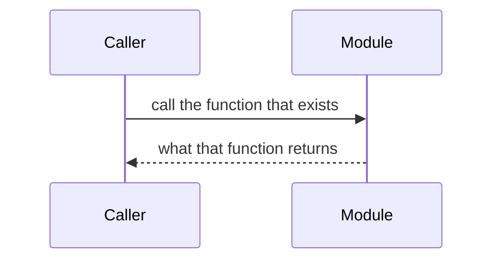

# Documentation style guide

Conventions the documentation batches have been following, so the next doc matches the
ones already in the tree. This file is the source for those conventions. It does not
restate product behaviour.

## File placement and naming

Put a document in the `docs/` folder of the app it describes. Those folders are flat:
one file, no subdirectories.

| Folder | What goes there |
| --- | --- |
| `apps/web/docs/` | The Next.js client |
| `apps/backend/docs/` | The Express gateway |
| `apps/ai_agent/docs/` | The FastAPI service |
| `contracts/docs/` | The Soroban contracts |
| `docs/` | Cross-cutting material: architecture, threat model, runbooks, ADRs, user guides |

Root `docs/` is the exception that has subfolders, and only for material that is not
owned by one app: `adr/`, `security/`, `user-guide/`, `flows/`. Do not add a new
subdirectory inside an app `docs/` folder. If a document is only about one app, it does
not belong in root `docs/`.

File names are kebab-case. Prefer one of these prefixes. The prefix is the kind of
document, not a topic tag.

| Prefix | Use it for | Examples already in the tree |
| --- | --- | --- |
| `api-` | A callable surface: routes, client wrappers, contract entry points. Request, response, and errors. | `apps/backend/docs/api-auth.md`, `apps/web/docs/api-rest-client.md`, `contracts/docs/api-proposals.md` |
| `contracts-` | A shape other code depends on: a schema, an error catalog, a stored record, a serialised payload. | `apps/backend/docs/contracts-jwt-auth.md`, `apps/web/docs/contracts-indexeddb-schemas.md` |
| `concepts-` | How a subsystem works in the current code: who calls whom, what is persisted, what the limits are. | `apps/web/docs/concepts-message-pipeline.md`, `apps/backend/docs/concepts-delivery-fanout.md` |
| `howto-` | A task recipe a contributor follows to add something, with one worked example taken from code that exists. | `apps/backend/docs/howto-add-rest-endpoint.md`, `apps/backend/docs/howto-add-socket-event.md` |
| `tutorial-` | A walkthrough that starts from a clean checkout and ends at a running result. | `contracts/docs/tutorial-testnet-treasury.md` |

Two other names are already established. Use them instead of inventing a new prefix:
`components-` for a UI component reference (`apps/web/docs/components-ui.md`), and a bare
name for a single app-wide guide that is none of the five (`testing.md`, `styling.md`,
`accessibility.md`). A new bare name needs a reason the five prefixes do not fit.

When a document is added, moved, or removed, update its row in
[`docs/README.md`](README.md) in the same change. That index is how the file gets found.

## Write against the current code

Describe what the code does on the branch you are editing. Read the file you name.
`IMPLEMENTATION_DOCS.md` is not the source of truth. It records intent and it drifts. If
it disagrees with the code, the doc follows the code.

State a limitation in the same place as the behaviour it limits. A phase, a feature flag,
or a one-line swap that is not the live assignment is not shipped. Name the live symbol.
Example: message encryption's live default is `Phase1SessionCrypto` assigned to
`defaultSession` in `apps/web/src/lib/session.ts`. `LibsignalSessionCrypto` is in that
file and is not the default. A doc that says the client uses the Signal protocol is
describing intended behaviour.

Do not paste an endpoint table, a storage layout, or a derivation that already has a
canonical page. Link to that page. Repeat a fact only when the reader cannot follow the
link and still do the task, and then keep the repeat to a sentence.

## Diagrams, code references, and cross-links

Use a [Mermaid](https://mermaid.js.org/) fence for a sequence or a flow. One diagram per
flow. Participant names should be the module or the process a reader can find in the
repo (`MlsClient`, `Backend`), not "the system".

Refer to code with a repo-relative path, and a symbol when the path is not enough:
`apps/web/src/lib/identityTrust.ts` `checkIdentityChange`. Markdown links to other docs
are relative (`../backend/docs/mls-key-packages.md` from a web doc, `./api-users.md`
from a sibling). Do not link to a machine path, a branch URL, or a line number that will
rot on the next edit. A GitHub issue link is fine when the doc exists because of that
issue.

## Marking a doc that a known change will stale

When you know a specific change will make a section wrong, put this quote under the
heading it applies to, naming the change in a way a later editor can grep:

> **Stale when:** `defaultSession` in `apps/web/src/lib/session.ts` is switched from
> `Phase1SessionCrypto` to `LibsignalSessionCrypto`. Replace the Phase-1 description in
> this section in that change.

Rules for the marker:

- Name the file and the symbol that will change, not a vague "when Signal ships".
- The sentence after the condition says what to edit.
- Delete the marker in the change that makes it true. Leaving it after the change is
  the same as the section being wrong.
- Do not use the marker as a TODO list for work nobody has scheduled. If the code is
  already different from the doc, fix the doc.

## Checklist for reviewing a docs PR

- [ ] The file is in the right `docs/` folder, flat, kebab-case, and uses a prefix from the table above.
- [ ] [`docs/README.md`](README.md) has a row for every added file and no row for a deleted one.
- [ ] Behaviour matches the current code. The review can point at the file named in the doc.
- [ ] Limitations are stated next to the behaviour. Intended phases are labelled as not live.
- [ ] `IMPLEMENTATION_DOCS.md` was not used as the source.
- [ ] Server behaviour, schemas, and algorithms that already have a page are linked, not copied.
- [ ] Paths are repo-relative. Mermaid fences parse.
- [ ] A section that a known change will invalidate has a **Stale when** quote, and the quote names the change.
- [ ] A doc that replaces another one deletes the old file and updates every inbound link in the same PR.
