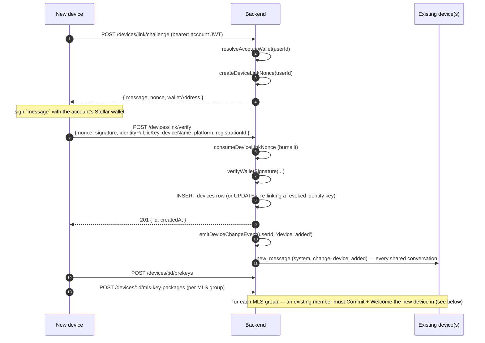

# Flow: linking a new device

Adding a second device to an account, start to finish: the challenge/verify handshake
that proves the new device is controlled by the account owner, publishing that device's
key material, how existing devices and MLS groups learn about it, and the reverse flow
(revocation).

## Contents

- [Sequence diagram](#sequence-diagram)
- [Step 1: challenge](#step-1-challenge)
- [Step 2: verify and register](#step-2-verify-and-register)
- [Step 3: key material upload](#step-3-key-material-upload)
- [What history the new device can and cannot read](#what-history-the-new-device-can-and-cannot-read)
- [What other users see: the key-change notice](#what-other-users-see-the-key-change-notice)
- [Audit events](#audit-events)
- [Revocation: the reverse flow](#revocation-the-reverse-flow)
- [A real gap: no client UI for this flow yet](#a-real-gap-no-client-ui-for-this-flow-yet)
- [Implementation references](#implementation-references)

## Sequence diagram



## Step 1: challenge

`POST /devices/link/challenge` — authenticated as the account (an existing session's
JWT, not yet the new device's own session), rate-limited to 10 requests/minute
(`device_link_challenge`, a separate bucket from the auth challenge/verify limits
specifically so hammering device-linking can't lock out normal sign-in):

```ts
const walletAddress = await resolveAccountWallet(userId);
const nonce = createDeviceLinkNonce(userId);
res.json({ message: deviceLinkMessage(userId, nonce), nonce, walletAddress });
```

Fails with 400 if the account has no wallet associated (`walletAddress` is `null`) —
device linking requires a wallet signature, so an account that never connected one
cannot add a second device via this flow at all.

## Step 2: verify and register

`POST /devices/link/verify` — rate-limited tighter, 5/minute (`device_link_verify`),
since this is the signature-checking step an attacker would actually want to brute
force:

1. **The nonce is consumed first, before any signature work**:
   `consumeDeviceLinkNonce(userId, body.nonce)` — single-use by construction. This
   ordering matters: a nonce cannot be reused to retry signature verification against
   the same challenge, and a replayed verify request (same nonce, any signature) always
   fails on the second attempt regardless of whether the first attempt's signature was
   valid.
2. **Signature check**: `verifyWalletSignature(walletAddress, deviceLinkMessage(userId,
   body.nonce), body.signature)` — this is what actually proves the request came from
   whoever controls the account's wallet, not merely whoever has a valid JWT for the
   account.
3. **Registration**: looks up an existing `devices` row for `(userId,
   identityPublicKey)`.
   - If one exists and is **not** revoked: `409 Device already registered for this
     user` — the same identity key cannot be linked twice while active.
   - If one exists and **is** revoked: the row is updated (`deviceName`, `platform`,
     `registrationId`, `revokedAt = null`) rather than inserting a new row. Re-linking a
     previously-revoked identity key reactivates it; it does not create a duplicate
     device for the same cryptographic identity.
   - Otherwise: a fresh `devices` row is inserted.
4. **Side effects on success**: `emitDeviceChangeEvent(userId, 'device_added')` (see
   [below](#what-other-users-see-the-key-change-notice)) and an audit event (see
   [below](#audit-events)), both fired without being awaited (`void`) — a failure in
   either does not fail the registration response itself.

## Step 3: key material upload

Registration alone does not make the new device usable — it still needs to publish the
key material other devices will use to establish sessions with it:

- `POST /devices/:id/prekeys` — signed prekey and one-time prekeys (see
  [`concepts-x3dh-double-ratchet.md`](../../apps/web/docs/concepts-x3dh-double-ratchet.md)
  for what these are and how a sender uses them).
- `POST /devices/:id/mls-key-packages` — one MLS `KeyPackage` per MLS group the device
  needs to be addable to. This route rejects with 403 if the device is already revoked
  (a device can't publish key material for a conversation after it's been locked out) or
  if the caller isn't that device's owner. Uploads are idempotent — re-sending a package
  the device already published counts as a duplicate rather than storing it twice, so a
  client retrying a timed-out request doesn't inflate its own inventory.

For **MLS groups specifically**, publishing a key package is necessary but not
sufficient for the new device to actually be addable in that group: an existing member
must pick up the new device (via `GET /conversations/:id/mls/pending-devices`) and
perform the Add-proposal + Commit + Welcome flow described in
[`mls-group-membership.md`](../../apps/backend/docs/mls-group-membership.md#join-flow-for-a-newly-linked-device).
This is not automatic — see that document for the full sequence and why it's a separate,
decoupled step.

## What history the new device can and cannot read

**DMs**: a newly-linked device has no server-side history to catch up on beyond what
`/sync`'s envelope-catch-up endpoint delivers going forward (undelivered envelopes for
its own device id, from the point its prekeys/registration exist onward — see
[`concepts-message-edit-delete.md`](../../apps/backend/docs/concepts-message-edit-delete.md#what-an-offline-device-sees-on-reconnect--sync)
for exactly what that endpoint filters). There is no mechanism that re-encrypts past DM
history for a newly-added device; it sees new messages from the moment it's linked
onward, nothing retroactive.

**MLS groups**: the same "no history transfer" property holds, for a cryptographic
reason rather than just an unimplemented feature — see
[`mls-group-membership.md`'s "Why history does not transfer"](../../apps/backend/docs/mls-group-membership.md#why-history-does-not-transfer).
A device added at epoch 7 holds epoch-7-and-later secrets only; there is no key on the
server to backfill earlier epochs with, because the server never had one. Backfilling
MLS history would require an existing device to re-encrypt and re-send old plaintext
specifically for the new device — a separate, deferred feature, not something this
linking flow does.

## What other users see: the key-change notice

`emitDeviceChangeEvent(userId, change)` (`routes/devices.ts`) runs on both linking
(`'device_added'`) and revocation (`'device_revoked'`) and does the same thing either
way: for **every conversation** the affected user is a member of, it inserts a `system`-
type message with no ciphertext and a structured `systemPayload: { userId, change }`,
then broadcasts it:

```ts
io.to(conversationRoom(m.conversationId)).emit('new_message', msg);
io.to(m.conversationId).emit('new_message', msg); // backward-compat room
```

This is the same double-room-emit pattern (two different Socket.IO room names, both
joined by every connected socket, so the event arrives twice per device-change) already
documented for `delete_message` in
[`concepts-message-edit-delete.md`](../../apps/backend/docs/concepts-message-edit-delete.md#delete_message) —
not unique to this flow, a recurring pattern in this codebase's socket layer. Every other
member of every shared conversation receives this notice, giving clients the hook to
show something like "Alice added a new device" or "Alice's device was removed" inline in
the conversation, without the server naming or fingerprinting the specific device in the
payload — only the change type and whose account changed.

## Audit events

Both `device_linked` (on successful `/link/verify`) and `device_revoked` (on `DELETE
/devices/:id`) are recorded via `recordAuditEvent`, each carrying:

- `targetType: 'device'`, `targetId`: the device's id
- `deviceName`, `platform` (as supplied/stored for that device)
- `device_linked` additionally records `reactivatedRevokedDevice: boolean` — whether this
  was a brand-new device or a previously-revoked identity key being relinked; the
  distinction matters because reactivating a revoked key after a revocation that was
  meant to lock someone out is a meaningfully different event from a genuinely new
  device appearing.
- `device_revoked` additionally records `selfRevocation: boolean` (whether the device
  being revoked is the same one making the request) and `remainingActiveDevices`
  (the count after this revocation) — revoking the device you're currently using reads
  very differently from revoking one you no longer hold, and a low remaining count is
  itself a signal worth having in the audit trail.

## Revocation: the reverse flow

`DELETE /devices/:id` — idempotent (revoking an already-revoked device just echoes back
the existing `revokedAt` rather than erroring) and refuses to revoke a caller's **only**
active device (`409 Cannot revoke your only active device` — there would be no way back
into the account). `POST /devices/logout-everywhere` is the same operation applied to
every device except the caller's current one in one call.

What revocation actually does, in `revokeDeviceRow`:

1. Sets `devices.revokedAt`/`updatedAt` — this is the authoritative "is this device
   still trusted" flag every other check in the codebase reads.
2. **Deletes** (not soft-deletes) every row in `devicePrekeys` for that device — a
   revoked device's prekeys are gone outright, not merely flagged, so nothing can be
   claimed against them going forward.
3. Releases any "prekeys low" latch for the device, so a later re-registration of the
   same identity key doesn't suppress the first legitimate low-prekey-count signal.
4. Force-disconnects any live socket for the device, cross-node via Redis pub/sub
   (`device_revoked:${deviceId}`) — a device that's mid-session when revoked doesn't
   get to finish that session.

**What's notably not deleted**: MLS key packages for the device are left in place by
`revokeDeviceRow` — only `devicePrekeys` rows are removed. A revoked device's
already-uploaded MLS key packages remain in the table (though the device itself can no
longer be meaningfully added to anything, since `is this device trusted` is gated on
`revokedAt`, checked independently wherever a key package would be consumed).

Peers see the same `device_revoked` key-change notice described
[above](#what-other-users-see-the-key-change-notice) — there is no separate "device
revoked" notification channel; it is exactly the same system-message mechanism linking
uses, just with a different `change` value.

## A real gap: no client UI for this flow yet

A repo-wide search for the linking endpoints' names found no caller in `apps/web/src` —
`/devices/link/challenge`, `/devices/link/verify`, `deviceLinkMessage`, and
`createDeviceLinkNonce` have zero references on the client side. The devices management
page (`app/app/devices/page.tsx`) only implements **revocation** of existing devices; it
has no "link a new device" action. The backend flow described above is fully
implemented and presumably reachable via a direct API call, but as of this writing there
is no UI path for a user to actually add a second device to their account through the
web client.

## Implementation references

- `apps/backend/src/routes/devices.ts` — `/link/challenge`, `/link/verify`, prekey/MLS-key-package upload, `DELETE /:id`, `/logout-everywhere`, `emitDeviceChangeEvent`, `revokeDeviceRow`
- `apps/backend/src/config/rateLimits.ts` — `device_link_challenge`, `device_link_verify`
- `apps/web/src/app/app/devices/page.tsx` — the devices management page (revocation only)
- [`mls-group-membership.md`](../../apps/backend/docs/mls-group-membership.md) — the group-join Commit/Welcome flow and why MLS history doesn't transfer to a newly-added device
- [`concepts-message-edit-delete.md`](../../apps/backend/docs/concepts-message-edit-delete.md) — the double-room-emit pattern this flow's key-change notice also exhibits, and the `/sync` envelope catch-up a newly-linked device relies on
- [`concepts-x3dh-double-ratchet.md`](../../apps/web/docs/concepts-x3dh-double-ratchet.md) — what the uploaded prekeys are for
